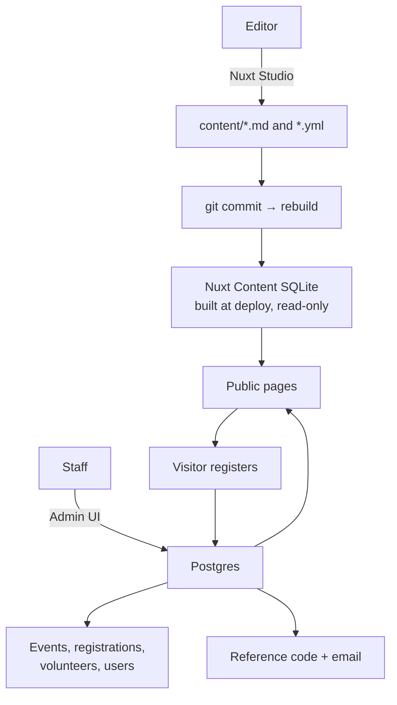

# Architecture plan

Cross-Love Movement's site is two systems sharing one deployment:

1. **A content site** — the marketing pages, written by people, published by git. Nuxt Content + Nuxt Studio.
2. **An operations app** — events, registrations, volunteers, users. A real database, an admin UI, and transactional rules.

Neither should absorb the other. The rest of this document explains the split, then plans the events feature as the first full vertical slice.

---

## 1. Two data planes



|         | Content plane                                | Operations plane                        |
| ------- | -------------------------------------------- | --------------------------------------- |
| Storage | `content/` in git → SQLite at build          | Postgres                                |
| Changes | Commit + rebuild (seconds to minutes)        | Instant                                 |
| Editing | Nuxt Studio (prose, images)                  | Admin app (forms, tables)               |
| Good at | Articles, pages, gallery copy, FAQs          | Records, relationships, counts, history |
| Bad at  | Counters, uniqueness, relations, concurrency | Long-form writing, image-led pages      |

**Do not rebuild a CMS.** Studio already gives non-technical editors a good writing surface. The admin app exists for things prose cannot hold: a registration with a reference code, a volunteer with a status, a user with a role.

### Where each thing lives

| Thing                   | Plane                                           | Why                                           |
| ----------------------- | ----------------------------------------------- | --------------------------------------------- |
| News posts              | Content                                         | Editorial, long-form, image-led               |
| Project stories         | Content                                         | Marketing narrative                           |
| Portfolio pieces        | Content                                         | Gallery content                               |
| About, FAQs, site copy  | Content                                         | Rarely changes                                |
| **Events**              | **Operations**                                  | Capacity, CRUD, registrations, status changes |
| **Registrations**       | **Operations**                                  | Records, codes, check-in                      |
| **Volunteers**          | **Operations**                                  | Application status, skills, availability      |
| **Users / roles**       | **Operations**                                  | Auth, permissions                             |
| **Donations / pledges** | **Operations**                                  | Money, receipts, reporting                    |
| Partners                | Content now, DB if relationships become managed | Editorial list today                          |

Hybrid case: if a project needs operational data (budget, beneficiaries, milestones), keep its **story page** in Content and add a `projects` row in Postgres keyed by the content path. The narrative stays editable in Studio; the numbers become queryable.

### Consequence for events

Events leave `content/events/`. Keeping them in both places would mean two sources of truth for capacity — the exact bug this rewrite is meant to end. The site reads events from Postgres through a public API; Studio no longer owns them.

---

## 2. Database

**Postgres, provisioned by Coolify** (self-hosted, so no cost beyond the server).

Reasons: relations between users, events, registrations, and volunteers; concurrent admin writes; `SELECT … FOR UPDATE` for capacity; real backups; future reporting. SQLite was the right call for one table and is the wrong call for five entities.

**Query layer: Drizzle ORM.**

- Schema in TypeScript, so the API, admin forms, and tests share one type source.
- `drizzle-kit generate` produces plain SQL migrations you can read and review.
- Thin runtime, no codegen daemon, no native engine binary — works cleanly in the image.
- Queries stay SQL-shaped, which matters for capacity transactions.

Rejected: Prisma (heavier engine, codegen step), raw `pg` (no migrations or types), Kysely (good, but Drizzle's schema-as-code wins here).

### Layout

```
server/database/
  client.ts            # pg Pool + drizzle instance, closed on Nitro shutdown
  schema/
    index.ts
    users.ts           # users, roles
    events.ts          # events, event_registrations
    volunteers.ts      # (phase 3)
  migrations/          # generated SQL, committed
  seed.ts              # local development fixtures
```

Connection: `DATABASE_URL`, one pool per process, `max: 10`. Migrations run once per deploy, before the server starts, not from a request. With a single replica that is simply an entrypoint step; if replicas ever exceed one, wrap it in a Postgres advisory lock.

---

## 3. Events as the first full feature

### Tables

```sql
create table events (
  id                     uuid primary key default gen_random_uuid(),
  slug                   text not null unique,
  title                  text not null,
  category               text not null,
  summary                text not null,
  description            text not null,          -- markdown
  starts_at              timestamptz not null,
  ends_at                timestamptz not null,
  venue                  text not null,
  address                text not null,
  city                   text not null,
  capacity               integer not null check (capacity >= 0),
  registration_deadline  timestamptz,
  status                 text not null default 'draft',  -- draft | published | archived
  featured               boolean not null default false,
  image                  text,
  created_by             uuid references users(id),
  created_at             timestamptz not null default now(),
  updated_at             timestamptz not null default now()
);

create table event_registrations (
  id           uuid primary key default gen_random_uuid(),
  reference    text not null unique,            -- e.g. PLY-7K4M2Q
  event_id     uuid not null references events(id) on delete restrict,
  name         text not null,
  email        text not null,
  phone        text not null default '',
  attendees    integer not null check (attendees between 1 and 20),
  notes        text not null default '',
  status       text not null default 'confirmed', -- confirmed | cancelled | waitlisted
  consent_at   timestamptz not null,
  checked_in_at timestamptz,
  created_at   timestamptz not null default now(),
  cancelled_at timestamptz
);

create index on event_registrations (event_id, status);
create index on event_registrations (lower(email));
```

`registeredOffline` disappears. Offline bookings are simply registrations created by staff in the admin UI, with `created_by` set. One source of truth.

### Capacity without overbooking

```sql
begin;
select capacity from events where id = $1 for update;   -- serialises bookings per event
select coalesce(sum(attendees), 0) from event_registrations
  where event_id = $1 and status = 'confirmed';
-- if requested > capacity - taken → rollback with 409
insert into event_registrations (...) values (...);
commit;
```

Row lock per event, not per table. Two group bookings cannot both pass the check.

### Reference codes

Format: `PREFIX-XXXXXX` — a short event prefix plus Crockford base32 (no `I`, `L`, `O`, `U` to avoid transcription errors), for example `PLY-7K4M2Q`.

- Generated in the same transaction as the insert.
- `unique` index; retry on collision (rare, but cheap to handle).
- Emailed to the registrant and visible on their confirmation screen.
- Gives staff a check-in handle: `GET /api/admin/registrations?ref=…`.

### Public endpoints

| Route                               | Purpose                                     |
| ----------------------------------- | ------------------------------------------- |
| `GET /api/events`                   | Published, upcoming events with `remaining` |
| `GET /api/events/:slug`             | One event                                   |
| `POST /api/events/:slug/register`   | Booking → reference + email                 |
| `GET /api/registrations/:reference` | Look up own booking (email + reference)     |

### Admin endpoints (authenticated)

| Route                                        | Purpose                                  |
| -------------------------------------------- | ---------------------------------------- |
| `GET/POST /api/admin/events`                 | List, create                             |
| `GET/PATCH/DELETE /api/admin/events/:id`     | Read, edit, archive                      |
| `POST /api/admin/events/:id/publish`         | Move draft → published                   |
| `GET /api/admin/events/:id/registrations`    | List, search, CSV                        |
| `POST /api/admin/registrations/:id/check-in` | Check in                                 |
| `POST /api/admin/registrations/:id/cancel`   | Cancel, release seats, offer to waitlist |

Bulk actions and CSV export are table stakes for an events team.

### Email

Resend is already wired. Add:

- **Templates** for confirmation, cancellation, and a reminder (plain text + simple HTML, no framework needed).
- **`.ics` attachment** so the event lands in the registrant's calendar.
- **Outbox table** — commit the registration, write an outbox row, let a Nitro task/cron send and retry. A failed email must never roll back a booking, and a retried job must not send twice.

```sql
create table mail_outbox (
  id uuid primary key default gen_random_uuid(),
  kind text not null,
  to_email text not null,
  payload jsonb not null,
  status text not null default 'pending',  -- pending | sent | failed
  attempts integer not null default 0,
  last_error text,
  created_at timestamptz not null default now(),
  sent_at timestamptz
);
```

---

## 4. Accounts, roles, and portals

The site has three surfaces that share one `users` table:

| Surface       | Route                    | Who                                       |
| ------------- | ------------------------ | ----------------------------------------- |
| Public site   | `/`, `/events`, `/news`… | Everyone, no account needed               |
| Member portal | `/portal`                | Anyone with an account, role `member`     |
| Staff portal  | `/admin`                 | `viewer`, `editor`, `admin`, `superadmin` |

One login form at `/login`. After authenticating, the user is sent to the portal their role allows; a member who opens `/admin` is redirected, and vice versa. Guards live in route middleware (`/portal/**`, `/admin/**`) and in the API, not in the page components.

### Roles

| Role         | Can                                                                        |
| ------------ | -------------------------------------------------------------------------- |
| `member`     | Own profile, own registrations and reference codes, volunteer applications |
| `viewer`     | Read-only staff access to events and registrations                         |
| `editor`     | Create and edit events, manage registrations                               |
| `admin`      | Everything above, plus users and reports                                   |
| `superadmin` | Everything, plus promoting and suspending other staff                      |

Only `superadmin` can change roles. A member cannot promote themselves — role is never read from the request body in any endpoint that mutates a user.

### Sign-in method

**Invite-only accounts, email and password.** There is no public signup form: a superadmin or admin creates the account (member or staff) and the invitee sets their password from an emailed link. This keeps `/admin` unreachable by self-registration and keeps the member list curated.

- Passwords hashed with **scrypt** from `node:crypto` — no native dependency, no argon2 build step.
- Sessions via **`nuxt-auth-utils`**: sealed, signed cookies (`NUXT_SESSION_PASSWORD`), no session table to keep clean.
- **Password reset** and **invite acceptance** both use single-use tokens in `auth_tokens`, stored hashed, with an expiry. The raw token only ever exists in the email. Invite links expire in 7 days, resets in 1 hour.
- Generic responses everywhere (`If that email has an account, a link is on its way`), plus the existing rate limiter, so the endpoints cannot be used to enumerate accounts.
- Accepting an invite sets the password, marks the address verified, and moves the account from `invited` to `active`.

### Waitlist

Waitlisting is part of launch, not a later phase.

- When an event is full, the form switches from **Register** to **Join the waitlist**.
- A waitlisted booking has status `waitlisted`, takes **no** seat, and gets its own reference code and confirmation email.
- When a confirmed booking is cancelled, the freed seats are offered to the waitlist **first come, first served**, inside the same transaction that frees them. Promoted bookings receive an email telling them a place has opened.
- Staff can also see the waitlist per event and promote or remove entries manually from the admin table.

### Reference codes

Codes are **emailed only**. The public confirmation screen says “check your email for your reference” rather than printing the code, so the address on the booking is the thing that receives it. The member portal shows the member their own codes once signed in.

### Portal contents

**Member portal** (`/portal`)

- Upcoming events the member is registered for, with reference codes
- Profile: name, phone, password
- Volunteer application status (phase 5)
- Download or cancel a booking

**Staff portal** (`/admin`)

- Events CRUD, publish/archive
- Registrations: search, check-in by reference, cancel, export CSV
- Users: invite, change role, suspend (superadmin only)
- Reports (phase 4+)

Nuxt Studio stays exactly as it is: it protects **content** editing with GitHub. The portal protects **records** with the app's own accounts. Two separate doors into two separate systems, deliberately.

---

## 5. Repository shape

Feature slices, one per domain, mirrored on both sides:

```
app/
  features/events/{components,composables}
  features/admin/…               # shared admin UI: tables, forms, layout
  pages/admin/…                  # thin route shells
server/
  database/{client,schema,migrations}
  features/events/{repository,service,schemas}
  features/registrations/{repository,service}
  features/volunteers/…
  features/auth/…
  api/…                          # thin handlers, public and admin
shared/
  types/
  schemas/                       # zod, used by client and server
```

A true monorepo is unnecessary while there is one Nuxt app. These folders already give the boundaries a package split would. If a second consumer appears (a check-in app, a mobile scanner), that is the moment to extract `packages/db`.

---

## 6. Delivery plan

| Phase                       | Scope                                                                                                                           | Outcome                                                                                         |
| --------------------------- | ------------------------------------------------------------------------------------------------------------------------------- | ----------------------------------------------------------------------------------------------- |
| **0. Foundations**          | Postgres in Coolify, Drizzle, client, migrations, health check, deploy step, local `docker compose`                             | Deployable with a database                                                                      |
| **1. Events core**          | `events` + `event_registrations` + waitlist, public API, registration with reference + email outbox, move events out of Content | **Done** — events live in Postgres, bookings return references, waitlist promotes automatically |
| **2. Accounts and portals** | `nuxt-auth-utils`, invite/login/reset, users + roles, `/portal` and `/admin` shells, route guards                               | Members and staff sign in and land in the right place                                           |
| **3. Admin events**         | CRUD UI, publish/archive, registration table, search, CSV, check-in, cancel, waitlist promotion                                 | Event management, no more git edits                                                             |
| **4. Reliability**          | Outbox worker, reminder email, backups, retention, audit log                                                                    | Safe to run a real event                                                                        |
| **5. Volunteers**           | Applications, skills, availability, statuses                                                                                    | Second entity on the same foundations                                                           |
| **6. Money**                | Donations/pledges, receipts, reporting                                                                                          | Only if online giving is wanted                                                                 |
| **7. Projects**             | Operational rows linked to Content stories                                                                                      | Only when reporting needs them                                                                  |

Phases 0–3 are the real scope for "event management". Phase 4 is what makes it trustworthy.

---

## 7. Decisions

**Settled**

1. **Postgres** — provisioned in Coolify on `postgres:18-alpine`.
2. **Drizzle** — schema in `server/database/schema`, generated SQL in `server/database/migrations`.
3. **Superadmin seeded** from `SEED_SUPERADMIN_EMAIL` / `SEED_SUPERADMIN_NAME` at boot. Idempotent.
4. **Roles** — `superadmin`, `admin`, `editor`, `viewer`, `member`.
5. **Own auth + portals** — public site, member portal, staff portal. No GitHub login for members.
6. **Invite-only accounts**, password reset and invite acceptance by email link.
7. **Waitlist on launch**, first come, first served promotion on cancellation.
8. **Reference codes by email only**.

**Still open**

1. **Events leave Content entirely** — recommended, so capacity has one source of truth. Confirm.
2. **Who needs staff access** at launch, and at what role?
3. **Signup policy detail** — can staff add a member from the admin UI, or is every member created by the superadmin?

## 8. Migration notes

- The SQLite event store was removed. Events now live in Postgres, and `content/events/*.yml` no longer exists; bootstrap data is in `server/database/seed-events.ts`.
- The homepage carousel reads published upcoming events from the API, falling back to `app/data/slides.ts` when there are none.
- Keep `remaining` computed in one place (`server/features/events/`) and exposed in every response, so the carousel, listing, and form cannot disagree.
